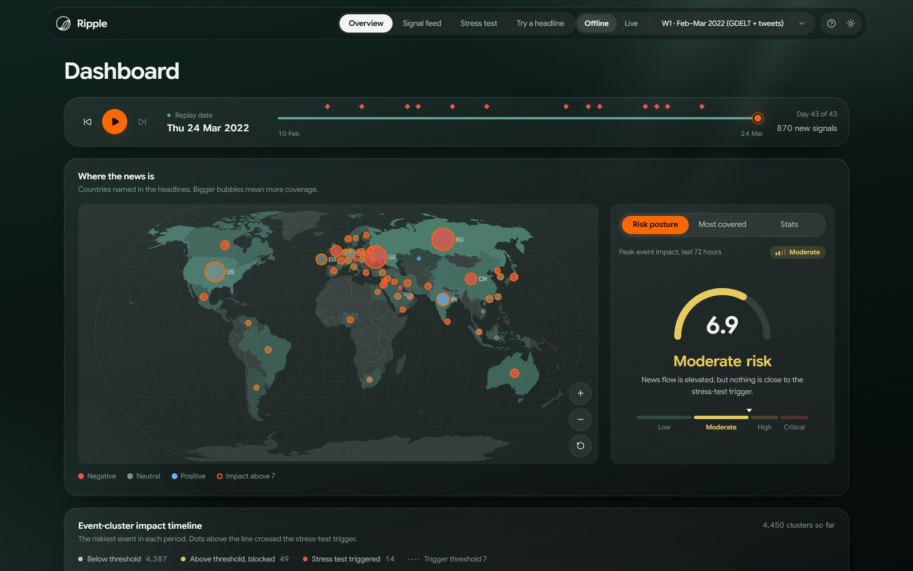
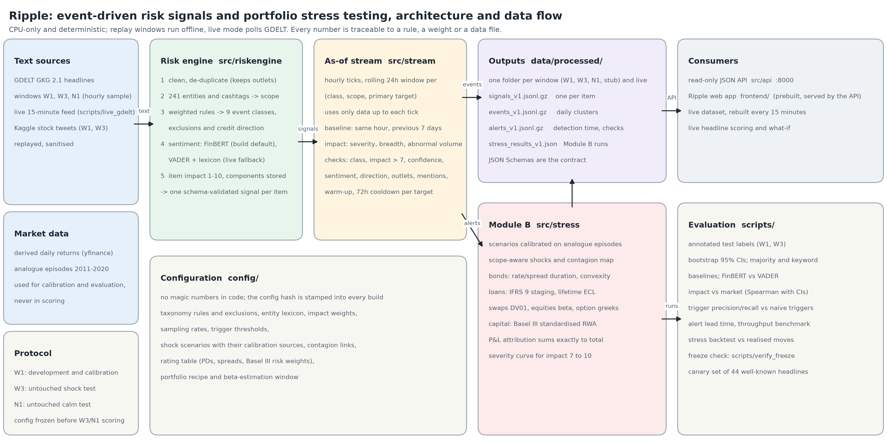
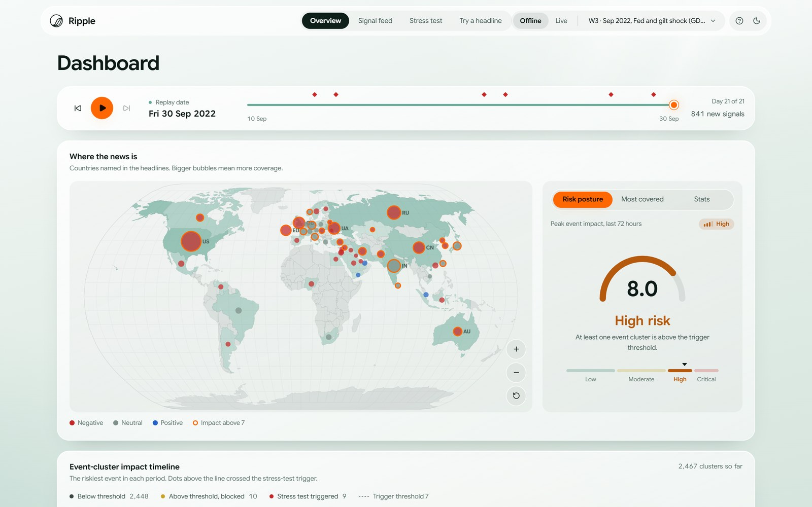
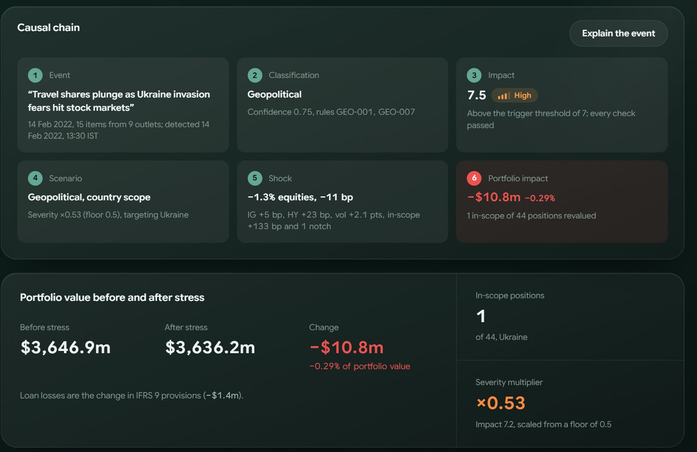
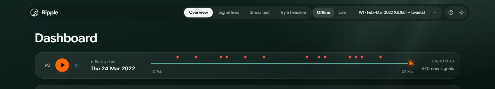
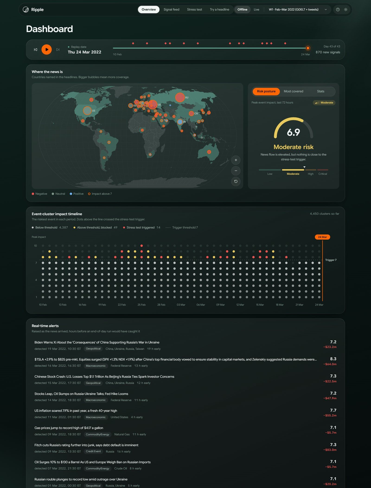
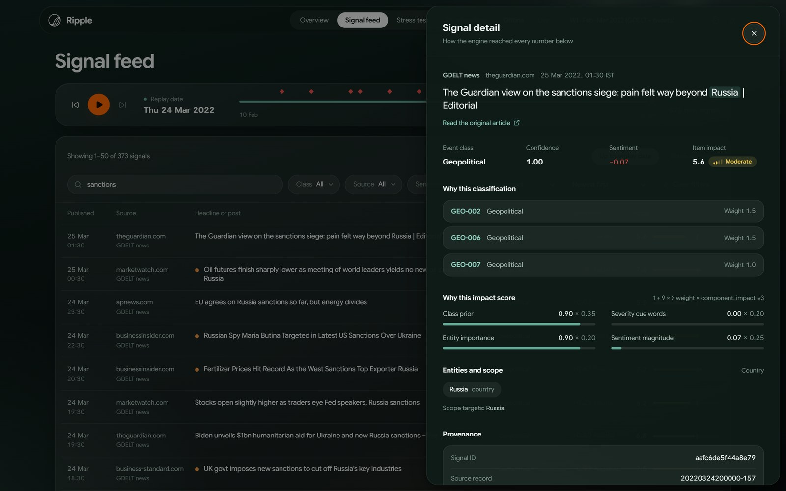
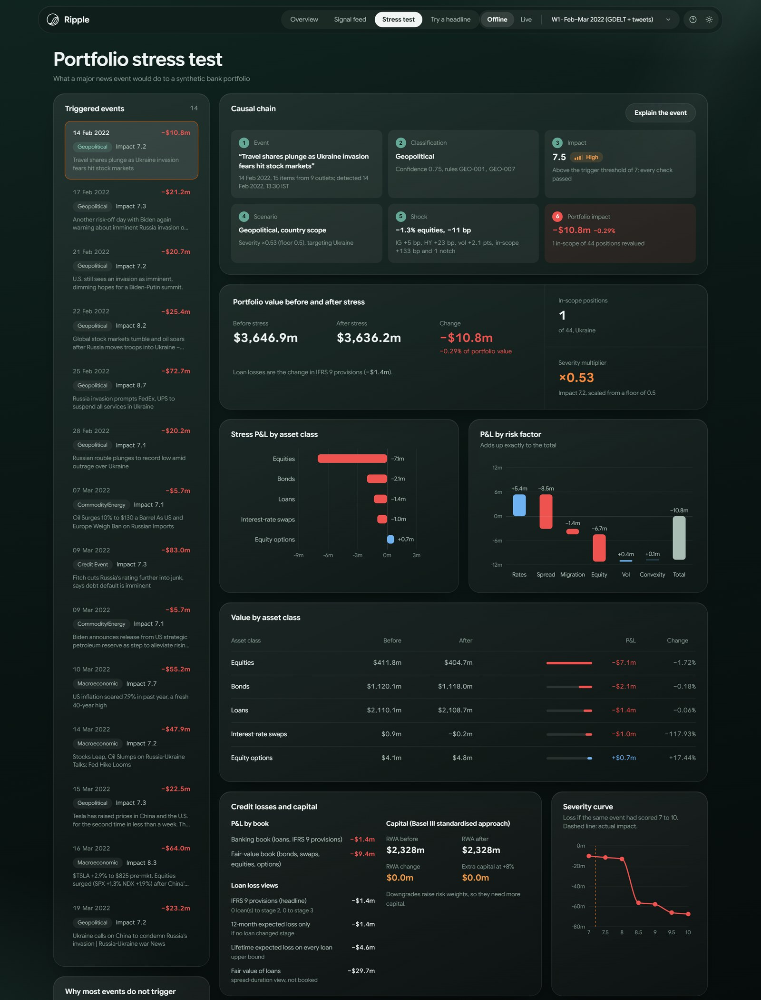
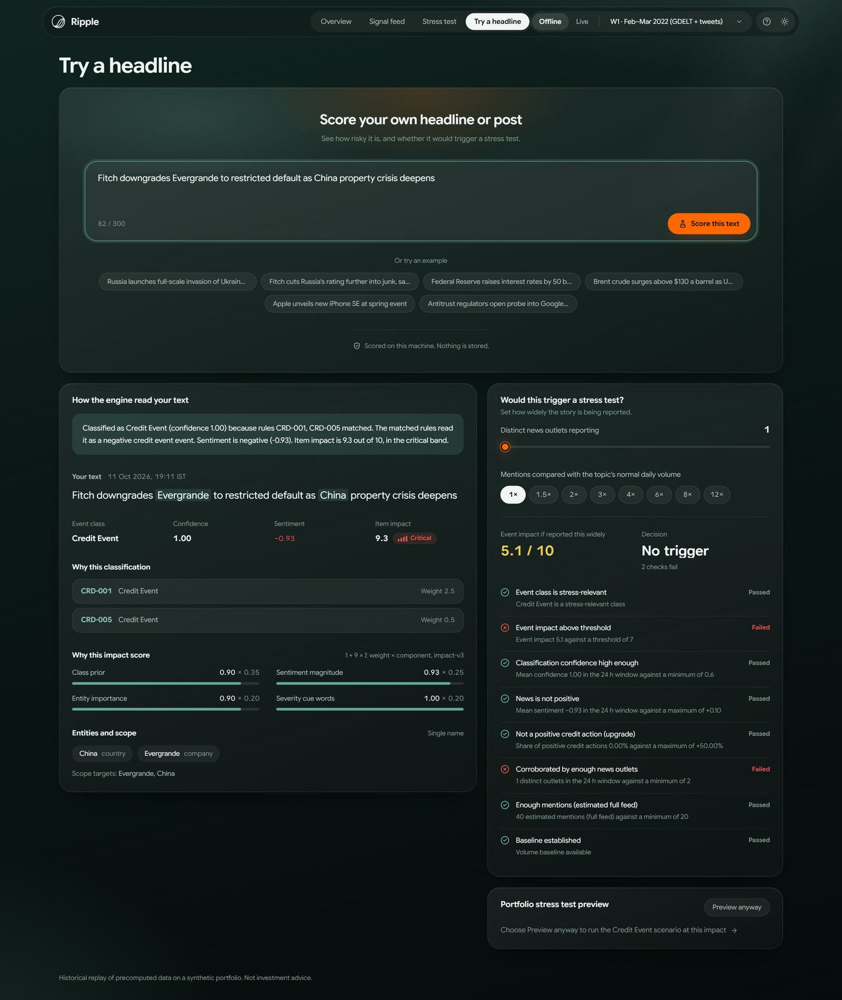

# Ripple: Event-Driven Risk Signals & Portfolio Stress Testing - S&P Global & Crisil Campus Hackathon

**Candidate Name:** Aishwary S Panwar\
**College Email ID:** aishwary23055@iiitd.ac.in\
**College / Campus:** IIIT Delhi\
**Demo Video Link:** _to be added_\
**Slide Deck Link (if hosted externally):** not hosted externally; the deck is [docs/presentation.pdf](docs/presentation.pdf)



News moves markets hours before a risk system sees a number. **Ripple** reads news headlines and social posts as they arrive, turns each one into a structured risk signal, and when an event looks serious enough, stress-tests a bank portfolio to show what it could cost. The name comes from the idea at its core: a single headline sends ripples through a portfolio.

## Contents

1. [Project overview / Problem statement & approach](#1-project-overview--problem-statement--approach)
2. [Architecture & tech stack](#2-architecture--tech-stack)
3. [Dataset used](#3-dataset-used)
4. [Quickstart & installation](#4-quickstart--installation)
5. [Key results & domain impact](#5-key-results--domain-impact)
6. [A tour of the app](#6-a-tour-of-the-app)
7. [Repository layout](#7-repository-layout)

## 1. Project overview / Problem statement & approach

**The problem.** The brief asks for an NLP engine that turns unstructured text from at least two sources into structured signals (sentiment, event class and a 1 to 10 impact score), exposes them through a file or an API, and drives at least one downstream module.

**What Ripple does.**

- **Scores the news.** Each GDELT headline and stock tweet gets an event class (one of nine), a FinBERT sentiment score, and a 1 to 10 impact score from a transparent rubric.
- **Raises alerts.** Related items are grouped into events and re-scored every hour using only data available at that hour. An event that passes eight checks raises an alert.
- **Stress-tests the portfolio (Module B).** Each alert stresses a synthetic bank book with historically calibrated shocks. Ripple shows the value before and after, IFRS 9 provisions, capital, and P&L that adds up exactly to the total.
- **Runs on replays and live.** Saved news windows replay day by day, and the same engine follows the live GDELT feed every 15 minutes. `python run.py` starts both.

**Why it is credible.**

- Every number traces back to a rule, weight or file in `config/`.
- Rules were tuned on one window and frozen (git tag `eval-freeze`) before two untouched windows were scored. Anyone can check this: `python -m scripts.verify_freeze` checks out the tag, re-scores the test labels with the frozen rules and reproduces the published 0.2.0 numbers.
- Results come with confidence intervals and baselines.
- No LLM is in the scoring path, and everything runs offline on a laptop CPU.

## 2. Architecture & tech stack



| Stage                  | How it works                                                                                                                                                                                                                                                                |
| ---------------------- | --------------------------------------------------------------------------------------------------------------------------------------------------------------------------------------------------------------------------------------------------------------------------- |
| Clean and de-duplicate | Strip HTML, links and handles; hash de-duplication that ignores trailing outlet and section tags, keeping duplicate counts and outlets                                                                                                                                      |
| Entities and scope     | 241 entities and cashtags decide whether an event is single-name, sector, country or macro                                                                                                                                                                                  |
| Event class            | 50 weighted rules over 9 classes, with exclusions (sport, crime, consumer debt, telecom tariff plans, labour strikes) and **direction** (a rating upgrade, a lifted ban or a truce is not a stress event)                                                                                   |
| Sentiment              | FinBERT (`ProsusAI/finbert`, pinned revision, CPU), neutral band chosen on the development sample; VADER with a finance lexicon as the live fallback                                                                                                                        |
| Item impact            | `1 + 9 × (0.35·class prior + 0.25·sentiment magnitude + 0.20·entity importance + 0.20·severity cues)`, components stored                                                                                                                                                    |
| As-of event impact     | Every hour, on a rolling 24 h window per (class, scope, target): `1 + 9 × (0.5·severity + 0.2·breadth + 0.3·abnormal volume)`. The baseline is the same hour on the previous 7 days, quiet days counted as zero, with no look-ahead ([details](docs/impact_calibration.md)) |
| Alert                  | Stress class, impact > 7, confidence ≥ 0.6, sentiment ≤ +0.1, not an upgrade, ≥ 2 outlets, ≥ 20 estimated mentions, past warm-up, and a 72 h cooldown per target group                                                                                                      |
| Stress scenarios       | Market shocks = 2× the worst week of historical analogues (Crimea 2014, taper tantrum 2013, US downgrade 2011, Libya 2011 and others) scaled by impact; targeted add-ons and contagion to linked countries; AAA/AA sovereigns are safe havens                               |
| Valuation              | Bonds: rate and spread duration plus convexity. Loans: IFRS 9 staging (stage 2 → lifetime ECL). Swaps: DV01. Equities: estimated beta. Options: delta, gamma, vega. Capital: Basel III standardised RWA                                                                     |

**Design choices.**

- **Precompute plus a thin runtime.** `python -m src.pipeline` writes versioned, schema-validated files (signals, events, alerts, stress results). The API only reads them. Builds are deterministic, and tests check that the committed outputs are current.
- **Live mode.** `python -m scripts.live_gdelt` backfills the last 7 days of GDELT hourly files, so the volume baseline and the 3-day warm-up are ready. It then adds every 15-minute file, re-runs the engine and Module B, and writes the `live` dataset. The API reloads it when the files change, and the web app refreshes every minute.
- **One interface.** A React app served by a standard-library JSON API that calls the same Python code. It never re-implements scoring or valuation.

**Tech stack.**

| Layer          | Tools                                                                                        |
| -------------- | -------------------------------------------------------------------------------------------- |
| Engine and API | Python 3.11 to 3.15, pandas, numpy, ruamel.yaml, jsonschema, vaderSentiment, requests; standard-library HTTP server |
| Web app        | React 19, TypeScript, Vite, Tailwind CSS, Recharts, d3-geo                                   |
| Build only     | PyTorch and transformers (FinBERT), yfinance, matplotlib                                     |
| Tests          | pytest (engine, stress, API), Vitest and Testing Library (web app)                           |

## 3. Dataset used

All data is public or synthetic, and nothing is downloaded at runtime except in live mode. Full provenance and licences: [data/SOURCES.md](data/SOURCES.md).

| Window                                                   | Role                        | News (GDELT GKG 2.1) | Tweets (Kaggle, CC0)     |
| -------------------------------------------------------- | --------------------------- | -------------------- | ------------------------ |
| W1, 10 Feb - 24 Mar 2022 (Russia-Ukraine war)            | Development and calibration | 27,784 headlines     | 8,916                    |
| W3, 10 - 30 Sep 2022 (US CPI, Fed 75 bp, UK gilt crisis) | Untouched test, shock       | 12,773               | 3,113                    |
| N1, 6 Aug - 4 Sep 2026 (calmest recent month)            | Untouched test, calm        | 14,981               | none (dataset ends 2022) |

Other data:

- **Derived market returns.** Only derived series from yfinance are committed. Raw prices are never redistributed, and none of it is used in scoring.
- **Synthetic portfolio.** 44 positions worth $3,646.9m: loans, bonds, swaps, equities and options. Credit obligors are synthetic; equities and options use real tickers.
- **Why the portfolio is not built from the brief's sample transaction data.** The suggested transaction datasets (Salad Money open banking, Kaggle card transactions) are retail spending and card records. They hold no loans, bonds or derivatives and no obligor ratings, so they cannot describe a wholesale banking book. Module B instead uses a seeded synthetic book built from [config/portfolio.yaml](config/portfolio.yaml) into [data/portfolio/portfolio_v2.csv](data/portfolio/portfolio_v2.csv), with the asset mix the brief asks for; a test checks it regenerates byte for byte.
- **Evaluation labels.** 200 development items plus 270 test items. Labels were produced by an automated annotation pass that follows [docs/labelling_guide.md](docs/labelling_guide.md); the development set was used for tuning and the test sets only for scoring.

**Assumptions.**

- GDELT timestamps are crawl times.
- The hourly sample is one GKG file in four, and counts are scaled accordingly.
- Tweets are replayed, not live.
- The portfolio deliberately tilts to CEE and emerging markets so regional shocks show. Because that choice was made knowing W1, the same book runs unchanged on W3 and N1.

Every judgement is listed in [docs/assumptions.md](docs/assumptions.md).

## 4. Quickstart & installation

**Runtime:** Python 3.11 to 3.15 (tested on 3.11, 3.12, 3.13, 3.14 and 3.15) on Windows 11. macOS and Linux use the same commands.

### Requirements

| Requirement | Version                    | Notes                                                                                                           |
| ----------- | -------------------------- | --------------------------------------------------------------------------------------------------------------- |
| Python      | 3.11 to 3.15               | [python.org/downloads](https://www.python.org/downloads/)                                                       |
| Node.js     | 20.19+ or 22.12+           | **Optional.** The built web app is committed in `frontend/dist`; Node is needed only if you change the frontend |
| Git         | any recent version         | to clone the repository                                                                                         |
| OS          | Windows 11, macOS or Linux | developed and tested on Windows 11                                                                              |

No GPU and no API keys are needed. An internet connection is needed for the first install and for the live feed; without it the offline replays still work.

### Quickstart (one command, offline and live)

```bash
git clone https://github.com/aishwaryspanwar/iiit-delhi-aishwary-panwar-hackathon.git
cd iiit-delhi-aishwary-panwar-hackathon
python run.py
```

On Windows, if `python` is older than 3.11, run it with an installed newer version, for example `py -3.15 run.py`.

This one command runs both modes:

- **Offline (ready in about a minute).** The saved news windows W1, W3 and N1 open at **http://127.0.0.1:8000**. Pick one from the dataset menu and press play to replay it.
- **Live (ready after about a few minutes).** The GDELT poller starts in the background. Its first poll downloads the last 7 days of hourly GDELT files (about 170 files) so the volume baseline and the 3-day warm-up are ready; after that it adds a new file every 15 minutes. As soon as the first poll finishes, the **Live** switch in the header becomes active.

`run.py` does everything:

1. creates a virtual environment in `.venv` and installs `requirements.txt` (first run only);
2. serves the committed web app build, and rebuilds it with npm only if the frontend sources have changed (it compares a hash of the sources with the one stamped in `frontend/dist`);
3. starts the API, waits until it is ready and opens **http://127.0.0.1:8000** in your browser;
4. starts the live GDELT poller (skip it with `--offline`);
5. stops everything when you press Ctrl+C.

| Option         | What it does                                                      |
| -------------- | ----------------------------------------------------------------- |
| `--offline`    | Replays only: do not poll the live GDELT feed (no internet needed) |
| `--port 8100`  | Use another port if 8000 is busy                                  |
| `--no-browser` | Do not open a browser tab                                         |
| `--rebuild`    | Rebuild the web app even if it looks current                      |

### Live feed details

```bash
python -m scripts.live_gdelt         # the poller on its own (run.py starts it for you)
python -m scripts.live_gdelt --once  # one refresh, then exit
```

- **Output:** each poll rewrites `data/processed/live/` (gitignored) with signals, events, alerts and a Module B stress result for every live alert. The API reloads it when the files change, and the web app refreshes every minute.
- **No internet:** the poller prints `poll failed, retrying in 60s` and keeps trying; the offline replays are unaffected.
- **No tweets in live mode:** live news has no social-media source, because the tweet dataset is historical.
- **Sentiment model:** VADER with the default install; FinBERT if the build requirements are installed.

### Manual setup (what `run.py` does)

```bash
python -m venv .venv
.venv\Scripts\activate          # Windows
source .venv/bin/activate       # macOS / Linux
pip install -r requirements.txt
python -m src.api               # serves the committed web app at http://127.0.0.1:8000
python -m scripts.live_gdelt    # optional, in a second terminal: the live feed
```

### Developing the web app

Run the API and the Vite dev server in two terminals:

```bash
python -m src.api               # terminal 1, repository root
cd frontend && npm ci && npm run dev   # terminal 2, http://127.0.0.1:5173 (proxies /api to port 8000)
```

After changing the frontend, `python run.py` rebuilds `frontend/dist` and stamps it with the new source hash; commit both.

API routes, design notes and frontend scripts are in [frontend/README.md](frontend/README.md).

### Rebuild data, evaluate and test

Rebuilding the data needs FinBERT, so it uses Python 3.11 to 3.14: PyTorch does not publish Python 3.15 wheels yet. Running the app and the tests works on every supported version.

```bash
pip install -r requirements-build.txt         # PyTorch, transformers, yfinance (build only)
python -m src.pipeline --dataset w1           # also w3, n1, stub
python -m scripts.evaluate                    # data/eval/metrics.json, window_comparison.json
python -m scripts.backtest_stress             # data/eval/backtest.json
python -m scripts.benchmark                   # data/eval/benchmark.json
python -m scripts.render_results              # docs/results.md
python -m scripts.verify_freeze               # re-score the test labels with the rules at the eval-freeze tag
python -m pytest -q                           # engine, stress and API tests
cd frontend && npm test                       # web app tests
```

### Troubleshooting

| Problem                              | Fix                                                                                                                                    |
| ------------------------------------ | -------------------------------------------------------------------------------------------------------------------------------------- |
| `Python 3.11 or later is required`   | Install Python 3.11 to 3.15 and run, for example, `py -3.15 run.py` (Windows) or `python3.15 run.py`                                   |
| `Node.js 20.19+ is required`         | Only shown if `frontend/dist` was deleted or the frontend was edited: install Node.js 20.19+ or 22.12+, then run `python run.py` again |
| Port 8000 already in use             | `python run.py --port 8100`                                                                                                            |
| The page loads but looks out of date | `python run.py --rebuild`, then refresh the browser                                                                                    |
| "Live" is greyed out in the header   | The first live poll is still running (about a few minutes), or there is no internet; the replays work meanwhile                         |
| Startup takes about a minute         | Expected on the first request: the API loads the datasets and the sentiment model                                                      |

## 5. Key results & domain impact

Full tables, with 95% confidence intervals: [docs/results.md](docs/results.md). Method: [docs/evaluation.md](docs/evaluation.md). Times are India Standard Time (IST).

### Engine versions, reported separately

- **0.2.0 (frozen, git tag `eval-freeze`).** Rules were tuned on W1 only, the configuration was frozen, and only then were W3 and N1 scored. These are the clean out-of-sample numbers, and `python -m scripts.verify_freeze` reproduces them from the tag.
- **0.3.0.** After the freeze, the vocabulary was widened so the live "Try a headline" demo handles common news it previously missed: policy actions (bans, tariffs, licence revocations, nationalisation), corporate events (guidance cuts, beats and misses, recalls, fraud), coups and unrest, credit stress (bail-outs, bank runs) and rate cuts.
- **0.3.1.** Bank failures, restricted and partial defaults, missed coupon or IMF payments and arrears, found by a regression set of well-known headlines from outside every evaluation window ([data/eval/canary_headlines.csv](data/eval/canary_headlines.csv), for example "Silicon Valley Bank collapses after a run on deposits"). The change left W1 development accuracy, every alert and every stress result unchanged.
- **0.3.2 (shipped).** Military strikes ("Israel strikes Iran nuclear sites"), state-backed cyberattacks on infrastructure, bank liquidity fears, aircraft groundings and crashes, and natural disasters, pandemics and lockdowns (mapped to the macroeconomic class, so no new class or scenario). Iran and Israel joined the conflict-region names. The canary set now has 44 headlines, all pinned by tests, plus tests that labour strikes, "strikes a deal" and post-pandemic headlines stay out. W1 development accuracy is unchanged (169 of 200), and so are W1 and W3 test macro-F1.

No test label was used to write the post-freeze rules, but they were written after W3 and N1 had been seen, so for 0.3.x those windows are no longer untouched. Every number below is from 0.3.2 unless marked as 0.2.0.

### Alerts on the shock window (W3, Sep 2022)

- 0.3.2 fired 10 alerts on 6 trading days: 83% precision and 100% recall against market-stress days (|S&P 500| > 1.5% or VIX +10%). Firing every day would score 67% precision. The frozen 0.2.0 engine fired 8 alerts on 5 days, with 80% precision and 83% recall.
- Read these with care. Six flagged days is a small sample: 5 hits out of 6 against a 67% base rate would happen by chance about one time in three (one-sided binomial p ≈ 0.35). A plain "impact above 7" rule without the other checks is as precise on W3 (89% on 9 flagged days) and has better recall on W1 (83% against 58%). What the eight checks buy is fewer stress runs: 12 instead of 20 flagged days on W1, and 5 instead of 7 false-alarm days on the calm N1 window.
- At 10:30 IST on 13 Sep it flagged the build-up of US inflation coverage, before the CPI release at 18:00 IST and the S&P 500's −4.3% day. This is anticipation of a scheduled release, not a forecast of the surprise.
- It flagged Fed coverage at 13:30 IST on 21 Sep, before the 75 bp decision at 23:30 IST, and again after it. It also flagged the gilt-market stress and Bank of England statements on 27 Sep, the day before the Bank's emergency gilt purchases on 28 Sep.
- Alerts arrive a median of 15 hours before an end-of-day batch run would see the same event, and all of them before the US close.



### Calm window (N1)

There were no market-stress days, yet 0.3.2 fired 6 alerts on 5 days (0.3.1 fired 8, 0.2.0 fired 4) on US macro, Russia-Ukraine and tariff news. These are false alarms in market terms: the engine measures how severe and abnormal the news is, not how markets will react. The wider policy vocabulary makes the engine more sensitive, and the calm window shows the cost.

### Stress results

- The calibrated scenarios cost the book −0.2% to −2.3% per alert.
- Credit events are the most severe. Fitch's Russia downgrade cost −$83.0m (−2.28%), mostly through bond spread widening (−$58.2m) and equity falls (−$42.9m), partly offset by lower rates. IFRS 9 provisions moved only −$3.4m, as one loan went to stage 2.
- Geopolitical market shocks are mild, because historical analogues show broad markets rarely fall far on geopolitics. The loss sits in the targeted exposures.



- In the backtest, the realised 1-day loss on the liquid sleeve stayed within the stressed loss after 93% (W1) and 80% (W3) of triggers.

### NLP quality on held-out labels

| Model                                 | W1 test              | W3 test              | Majority baseline | Keyword baseline  |
| ------------------------------------- | -------------------- | -------------------- | ----------------- | ----------------- |
| Event class, macro-F1 (0.3.2)         | **0.59** [0.44-0.72] | **0.35** [0.24-0.49] | 0.10 / 0.07       | 0.58 / 0.36       |
| Event class, macro-F1 (0.2.0, frozen) | 0.57 [0.43-0.69]     | 0.40 [0.28-0.54]     | 0.10 / 0.07       | 0.58 / 0.36       |
| Sentiment (FinBERT), macro-F1         | **0.57** [0.43-0.68] | **0.44** [0.34-0.54] | 0.27 / 0.25       | VADER 0.46 / 0.48 |

Both models clearly beat the majority baseline. Claims written down before scoring, and what happened:

- The rules beat a naive keyword classifier on W1 test with 0.3.x, but only within noise (0.59 vs 0.58; 0.2.0 did not). On W3 they do not (0.35 vs 0.36).
- FinBERT does not beat VADER on W3.

The wider vocabulary helped W1 test and the W3 alert recall, but lowered W3 event-class F1. One example is an export ban on rice, which 0.3.x reads as a regulatory action while the label says commodity. These results are reported, not tuned away: the test labels were not used to adjust the rules.

### What the NLP does and does not add

- **What it adds:** structure and auditability. Every headline becomes a typed, schema-validated record (class, direction, sentiment, impact with components, entities, scope), and every alert lists the rules, weights and checks behind it. A risk analyst can challenge any number, and changing a rule is a config edit, not a retraining run.
- **What it does not add:** accuracy over a strong keyword baseline. On held-out labels the rules tie a naive keyword classifier, and FinBERT ties VADER on W3. The value of the impact score is in deciding _when_ to run scenario analysis (83% alert precision on W3, against a 67% base rate), not in forecasting market moves: its day-to-day correlation with the S&P 500 is not significant within any single window.
- **Why rules and not a trained classifier:** with a few hundred labels a supervised model would overfit and be hard to audit, and an LLM in the scoring path would make results non-deterministic and impossible to run offline.

### Throughput

About 1,850 items/s end to end with VADER on a laptop CPU, and about 22 items/s for FinBERT, so a 15-minute GDELT file is scored well within its interval.

### Why it matters

A risk team sees within hours which headline moved which number:

- the matched rules and the impact components;
- the checks against their thresholds;
- the calibrated shocks and the analogue episodes behind them;
- the IFRS 9 stage moves and the capital cost.

Each piece can be audited, challenged and re-run from configuration. Ripple is a triage layer that decides when to run scenario analysis, not a market forecaster, and the evaluation shows where that line is.

## 6. A tour of the app

Ripple has one web interface with four pages. It works in dark and light themes (toggle in the top-right corner) and adapts to desktop screens from 1024 px up to 2560 px and wider.

**First visit.** A short guided walkthrough explains the app in six steps, and you can skip it at any point. To replay it later, click the **?** button in the header.

**Header controls.**

- **Offline / Live:** switch between replaying a saved news window and following the live feed.
- **Dataset menu:** choose a replay window (W1, W3, N1 or stub).
- **Replay bar** (Overview and Signal feed): press play to watch the window unfold day by day. Every chart follows the replay date, and red diamonds mark days when a stress test fired.



### Overview

The big picture: where the news is, how risky things are, and what the latest stress test did to the book.

- A world map of the countries in the news, with bubble size for coverage and colour for sentiment, next to a risk gauge for the last 72 hours. Scroll over the map to zoom, drag to pan.
- An event timeline drawn as a dot matrix: each column lights up to the impact of the riskiest event in that period, and dots above the dashed line crossed the stress-test trigger.
- Real-time alerts, showing how many hours earlier each one fired than an end-of-day run would have.
- The latest high-impact events, a breakdown of what the news is about, the latest stress test, and the market mood.



### Signal feed

Every news item and post with its event class, sentiment and impact, which is the engine's structured output. Search and filter by class, source, sentiment and impact. Click any row to open a panel showing exactly how it was scored: the rules that matched, the impact components and their weights, the entities found, and the record's provenance.



### Stress test

Module B. Pick any triggered event to see:

- the causal chain: event → classification → impact → scenario → shock → portfolio;
- portfolio value before and after the stress;
- P&L by asset class and by risk factor;
- credit losses and capital, and the severity curve;
- the shocks applied and the trigger checks;
- every position revalued.



### Try a headline

Type any headline and Ripple scores it live with the same engine. It then shows whether the story would trigger a stress test. Move the sliders for how many outlets report it and how unusual the volume is, and run a preview of the stress test on the portfolio. With the default install, live scoring uses VADER for sentiment (FinBERT needs `requirements-build.txt`), so a headline's sentiment here can differ from the FinBERT score it has in a replay window; the rules and impact rubric are identical.



## 7. Repository layout

| Path                          | Contents                                                                                                                                                                                                                         |
| ----------------------------- | -------------------------------------------------------------------------------------------------------------------------------------------------------------------------------------------------------------------------------- |
| `run.py`                      | One-command setup and launch                                                                                                                                                                                                     |
| `src/riskengine/`             | Cleaning, de-duplication, entities, rules, sentiment, impact, schemas                                                                                                                                                            |
| `src/stream/`                 | As-of streaming engine: rolling windows, baselines, alerts                                                                                                                                                                       |
| `src/stress/`                 | Portfolio, calibrated shocks, contagion, valuation, IFRS 9, capital, explanations                                                                                                                                                |
| `src/pipeline.py`, `src/api/` | Batch pipeline and the read-only JSON API                                                                                                                                                                                        |
| `frontend/`                   | The Ripple web app (React); `frontend/dist` is the committed production build                                                                                                                                                    |
| `scripts/`                    | Data fetching, live GDELT poller, labelling, calibration, evaluation, backtest, benchmark, freeze check, diagram                                                                                                                 |
| `config/`                     | Every rule, weight, threshold, scenario and the portfolio recipe (no magic numbers in code)                                                                                                                                      |
| `data/`                       | All inputs and outputs, with provenance in [data/SOURCES.md](data/SOURCES.md)                                                                                                                                                    |
| `docs/`                       | [results](docs/results.md), [evaluation](docs/evaluation.md), [impact calibration](docs/impact_calibration.md), [assumptions](docs/assumptions.md), [labelling guide](docs/labelling_guide.md), [data spike](docs/data_spike.md) |
| `docs/screenshots/`           | App screenshots used in this README                                                                                                                                                                                              |
| `tests/`                      | Engine, stress, stream, API and launcher tests                                                                                                                                                                                   |
